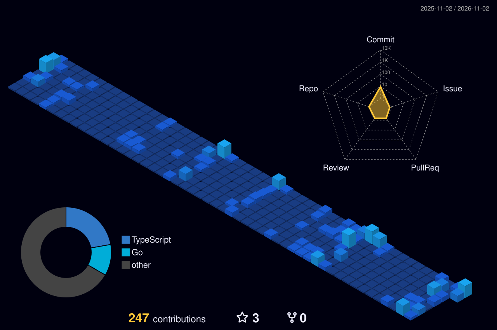

## 🚀 Projects

| Project | Description | Stack |
|---|---|---|
| **Realtime Customer Support Platform** | A fast and secure realtime customer support platform that connects customers with support agents instantly. | Node.js · Redis · PostgreSQL |
| **Fast Food Delivery App (UAE)** | Designed and built the entire backend for the user app, admin panel, shopkeeper app and delivery partner app, with realtime order tracking and realtime order distribution. | Node.js · Express.js · MongoDB |

## 🌃 My Contribution City

